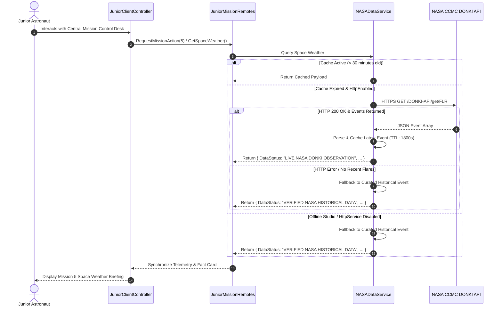

# ASTROVERSE — NASA Data Integration & Open Science Pipeline

## 1. NASA DONKI Overview

ASTROVERSE integrates with the **NASA Space Weather Database of Notifications, Knowledge, Information (DONKI)**, operated by the **Community Coordinated Modeling Center (CCMC)** at NASA's Goddard Space Flight Center in Greenbelt, Maryland.

DONKI is an open, comprehensive on-line database of space weather notifications, observations, models, and interpretations developed specifically to track solar storms (solar flares, coronal mass ejections, solar energetic particle events, and geomagnetic disturbances) across the solar system.

In ASTROVERSE, this data serves as the foundation for **Mission 5 (*Solar Weather Watch*)**, educating players on how space weather scientists monitor solar cycles and protect astronauts and satellites from high-energy radiation bursts.

---

## 2. API Endpoint Architecture

### 2.1. Migration & Authentication Compliance
Effective **September 30, 2026**, the NASA CCMC transitioned DONKI service endpoints to direct CCMC infrastructure. ASTROVERSE is fully compliant with this architecture:
- **Base Endpoint:** `https://ccmc.gsfc.nasa.gov/DONKI-API/get/`
- **Target Route:** `FLR` (Solar Flares)
- **Full Query URI:**  
  `https://ccmc.gsfc.nasa.gov/DONKI-API/get/FLR?startDate={YYYY-MM-DD}&endDate={YYYY-MM-DD}`
- **Authentication:** Public open access (No client-side or developer API keys required).
- **HTTP Method:** `GET`
- **Payload Format:** JSON array of solar flare event records.



---

## 3. Data Schema & Field Mapping

When `NASADataService.GetSpaceWeather()` executes, it standardizes both live API responses and historical fallbacks into a uniform Luau table schema:

```lua
export type SpaceWeatherReport = {
    DataStatus: string,       -- "LIVE NASA DONKI OBSERVATION" | "VERIFIED NASA HISTORICAL DATA"
    IsLive: boolean,           -- true if fetched live from CCMC; false if fallback
    IsQuietSun: boolean,       -- true if Sun is currently quiet and no major flares detected
    Source: string,           -- "NASA DONKI LIVE FEED" | "NASA DONKI ARCHIVE"
    SourceFull: string,       -- Full formal name of the CCMC DONKI database
    FlareClass: string,       -- Standard solar flare classification (e.g., "Class M2.5 Solar Flare")
    PeakTime: string,         -- Timestamp in UTC (e.g., "2024-05-10 12:45 UTC")
    BeginTime: string,        -- Flare onset timestamp in UTC
    Instrument: string,       -- Observing satellite instrument (e.g., "GOES-16 Satellite (SUVI)")
    ActiveRegion: string,     -- Solar active region number (e.g., "Sunspot Region AR3664")
    SourceLocation: string,   -- Heliographic coordinate location (e.g., "S18W89")
    Summary: string,          -- Plain-language summary suitable for 7–12 year olds
    SafetyAction: string,     -- Associated astronaut drill in Moon Base Alpha
    WebLink: string,          -- Official CCMC archive URL for deeper inspection
    Attribution: string,      -- Required open-science attribution notice
}
```

---

## 4. Caching & Server Resource Respect

To comply with NASA Open Data fair-use guidelines and prevent unnecessary traffic to government servers:

1. **30-Minute In-Memory TTL:**  
   `CACHE_TTL_SECONDS = 1800` (1,800 seconds). Subsequent requests within this window return immediately from memory without making external web calls.
2. **Server-Side Execution Only:**  
   The Roblox client never initiates HTTP calls. All requests originate strictly from the Roblox game server (`ServerScriptService.NASADataService`), ensuring client network bandwidth is preserved.
3. **Bounded Rolling Window:**  
   Queries request a rolling 7-day date window (`startDate = today - 7 days`, `endDate = today`) to minimize JSON payload sizes.

---

## 5. Resilient Historical Fallback Architecture

### 5.1. Fallback Triggers
The historical fallback activates automatically when:
- Running in an offline Roblox Studio session where `HttpService.HttpEnabled = false`.
- The game server encounters a DNS resolution failure, network timeout, or HTTP 5xx error.
- NASA's API returns an empty array (indicating a period of "Quiet Sun" with zero solar flares in the past 7 days).

### 5.2. Verified Historical Event Record
The fallback is not an artificial placeholder. It is an authentic, verified historical space weather event from the peak of **Solar Cycle 25**:

```lua
local VERIFIED_FALLBACK_EVENT = {
    DataStatus = "VERIFIED NASA HISTORICAL DATA",
    IsLive = false,
    IsQuietSun = false,
    Source = "NASA DONKI ARCHIVE",
    SourceFull = "NASA Space Weather Database of Notifications, Knowledge, Information (DONKI)",
    FlareClass = "Class M2.5 Solar Flare",
    PeakTime = "2024-05-10 12:45 UTC",
    BeginTime = "2024-05-10 12:30 UTC",
    Instrument = "GOES-16 Satellite (Solar Ultraviolet Imager / SUVI)",
    ActiveRegion = "Sunspot Region AR3664",
    SourceLocation = "S18W89",
    Summary = "A major solar flare was observed erupting from an active sunspot region on the Sun during Solar Cycle 25.",
    SafetyAction = "In ASTROVERSE, this historical report triggers an educational astronaut shelter safety drill.",
    WebLink = "https://ccmc.gsfc.nasa.gov/DONKI/view/FLR/30406/-1",
    Attribution = "Data provided courtesy of NASA Space Weather Database (DONKI), CCMC at Goddard Space Flight Center."
}
```

### 5.3. Educational Value of the May 2024 Event (Sunspot AR3664)
Sunspot Region AR3664 produced the historic geomagnetic superstorm of May 10–12, 2024—the most powerful solar storm to hit Earth and the Moon in over two decades, creating global auroras. Referencing this specific event connects players directly to modern space science history.

---

## 6. Security & Credential Hygiene

- **Zero API Keys in Source Code:** The CCMC DONKI endpoint is publicly accessible without developer authentication. The codebase contains zero API keys, secrets, or bearer tokens.
- **Client Isolation:** The client interface interacts exclusively via `JuniorMissionRemotes.GetSpaceWeather`. It never knows the origin IP, URL, or internal server headers.

---

## 7. Diagram Reference

- [NASA CCMC DONKI Data Pipeline Diagram](diagrams/nasa-data-pipeline.md)
