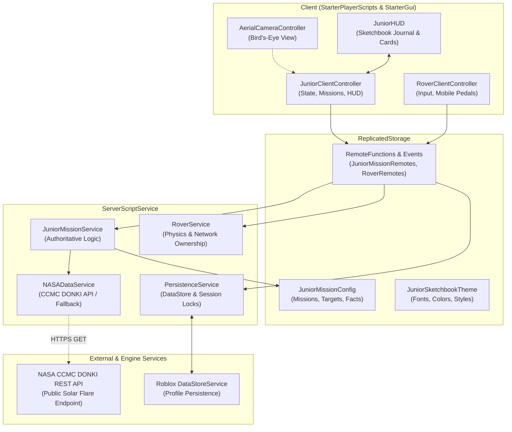

# ASTROVERSE 🚀
### Educational Lunar Mission-Training Experience for Junior Astronauts

[](https://www.roblox.com)
[](https://luau-lang.org/)
[-brightgreen)](docs/TESTING_AND_QA.md)
[](https://www.spaceappschallenge.org/)
[](LICENSE)

---

## 📖 Project Summary

**ASTROVERSE** is an open-source, educational lunar exploration and mission-training game built on the **Roblox platform** for children aged **7–12**, designed for the **NASA Space Apps Challenge 2026**. 

Players assume the role of a Junior Astronaut stationed at **Moon Base Alpha** in the lunar south pole region. Through an authentic, handwritten astronaut sketchbook and mission journal interface, players complete five hands-on training missions covering essential principles of lunar survival, renewable space power, environmental control and life support systems (ECLSS), radiation mitigation, extraterrestrial hydroponics, and space weather monitoring powered by NASA open science data.

The project pairs arcade-accessible controls with rigorous physical grounding: authentic lunar gravity (`32.4 studs/s²`), a 6-wheeled scientific rover with independent spring suspension and active downforce, an interactive bird's-eye Aerial Overview camera, and a resilient data pipeline querying the **NASA Community Coordinated Modeling Center (CCMC) DONKI API**.

---

## 🖼️ Gameplay Preview

```
+-------------------------------------------------------------------------+
|                                                                         |
|                     [ SCREENSHOT PLACEHOLDER ]                          |
|                                                                         |
|     Recommended Screenshot: Junior Astronaut at Moon Base Alpha with     |
|     the Lunar Rover parked near the Solar Array under Earthrise.        |
|                                                                         |
|     Path: assets/screenshots/screenshot_cleaned_lunar_environment.jpg    |
|                                                                         |
+-------------------------------------------------------------------------+
```
*(See [assets/screenshots/README.md](assets/screenshots/README.md) for full image staging instructions).*

---

## 🌟 Key Features

- **Handwritten Sketchbook UI/UX (Phase 8D/8E):** A kid-friendly mission journal rendered in warm cream paper (`#F8F4E8`), notebook margins, tape accents, and handwritten typography (`Kalam` and `PatrickHand` fonts) that feels like an astronaut's personal field diary.
- **Five Hands-On Educational Missions:** Guided training modules that translate complex aerospace engineering into engaging, interactive objectives.
- **NASA Space Weather Integration:** Real-time and verified historical solar activity monitoring querying the **NASA CCMC DONKI API** (`GOES-16 SUVI` instrument observations from Sunspot AR3664).
- **Smooth 6-Wheeled Lunar Rover:** Custom-tuned chassis featuring 6-wheel independent suspension, dynamic lunar downforce (`500–2400 N`), dual-stage anti-flip gyroscopic recovery, and mobile touch pedals.
- **Aerial Overview Camera:** Seamless bird's-eye tactical camera toggling between third-person astronaut view and a high-altitude base overview (`4, 215, 65`) with smooth cubic bezier transitions.
- **Historic & International Lunar Memorials:** Faithfully integrated Apollo 11 Memorial (historic plaque and American flag) and Tiranga Lunar Memorial (Chandrayaan-3 tribute and Indian flag).
- **Session-Hardened Persistence:** Safe server-authoritative progress saving with 300-second session locks, 90-second heartbeat renewals, 180-second autosaves, and offline Studio mock cache fallback.
- **Cross-Platform Accessibility:** Fully responsive design supporting desktop (keyboard/mouse) and mobile (phones/tablets with on-screen touch pedals).

---

## 🎯 The Five Junior Astronaut Missions

| # | Mission Name | Focus Area | Interactive Target | Educational Takeaway & NASA Reference |
| :-: | :--- | :--- | :--- | :--- |
| **1** | **Power the Moon Base** | Solar Power | Solar Power Switch (`24.6, 9.3, 223.2`) | Sunlight on airless bodies; photovoltaic energy capture without atmospheric loss (*NASA Solar Exploration*). |
| **2** | **Keep the Astronaut Safe** | Life Support | Life Support Oxygen Tank (`-13.0, 11.3, 274.5`) | Vacuum physiology; Environmental Control and Life Support Systems (*NASA ECLSS*). |
| **3** | **Shield Our Base** | Radiation Shield | Regolith Shield Console (`0.0, 14.0, 245.0`) | Cosmic rays, solar energetic particles, and in-situ regolith shielding (*NASA LRO CRaTER*). |
| **4** | **Grow Food on the Moon** | Space Botany | Greenhouse Hydroponic Bay (`-36.5, 10.0, 250.0`) | Closed-loop hydroponics, LED spectrums, and nutrition in space (*NASA Veggie & APH*). |
| **5** | **Solar Weather Watch** | Space Weather | Central Mission Control Desk (`4.5, 11.0, 255.2`) | Solar flare classification, CMEs, space weather alert protocols, and storm shelter drills (*NASA CCMC DONKI*). |

---

## 🏛️ System Architecture Overview



*(See [docs/SYSTEM_ARCHITECTURE.md](docs/SYSTEM_ARCHITECTURE.md) and [docs/diagrams/](docs/diagrams/) for complete architectural breakdowns).*

---

## 🛠️ Technology Stack

- **Game Engine:** Roblox Engine (Client/Server Architecture, Studio Build `version-63eb6055af4e4688`)
- **Programming Language:** Luau (Type-checked, sandboxed Lua 5.1 dialect)
- **Data APIs:** NASA Community Coordinated Modeling Center (CCMC) DONKI API (`https://ccmc.gsfc.nasa.gov/DONKI-API/get/FLR`)
- **Physics Engine:** Roblox Distributed Physics Engine (`Gravity = 32.4 studs/s²`, Custom VectorForce Downforce, SpringConstraints)
- **UI Framework:** Roblox ScreenGui with Procedural Canvas Scaling, Kalam & Patrick Hand Google Fonts
- **Data Persistence:** Roblox `DataStoreService` with 300s Session Leases and Memory Cache Mocking

---

## 🎮 Controls Quick Reference

| Action | Desktop (Keyboard & Mouse) | Mobile (Touch Screen) |
| :--- | :--- | :--- |
| **Astronaut Movement** | `W`, `A`, `S`, `D` / Arrow Keys | On-screen dynamic thumbstick |
| **Jump** | `Spacebar` (Low-gravity lunar leap) | Jump button |
| **Interact / Hold** | `E` (Hold for action duration) | Context-sensitive tap button |
| **Sprint** | `Left Shift` | Automatic / Double-tap |
| **Drive Rover** | `W` (Accelerate), `S` (Reverse), `A`/`D` (Steer) | On-screen pedal pads (`Forward`, `Reverse`, `Steer L/R`) |
| **Rover Handbrake** | `Spacebar` or `P` | `Brake` button |
| **Rover Headlights** | `L` | `Lights` button |
| **Rover Hover Boost** | `H` or `F` | `Hover Boost` button (5.5s burst, 12s cooldown) |
| **Exit Rover** | `Backspace` or `X` | `Exit Rover` button |
| **Aerial Overview Camera** | `V` or click top-right `Aerial` icon | Tap `Aerial View` icon / `Return to Astronaut` |
| **Open Logbook / Journal** | Click bottom journal icon | Tap bottom journal icon |

*(See [docs/CONTROLS.md](docs/CONTROLS.md) for deep input bindings and accessibility guidelines).*

---

## 🔬 NASA Open Data & Educational References

ASTROVERSE directly integrates and references open science materials provided by NASA:
1. **Solar Flare & Space Weather Data:** Provided by the **NASA Space Weather Database of Notifications, Knowledge, Information (DONKI)** developed by the CCMC at NASA Goddard Space Flight Center.
2. **Space Life Support (ECLSS):** Environmental Control and Life Support System engineering principles derived from the International Space Station and Artemis program documentation.
3. **Lunar Regolith Radiation Shielding:** Radiation measurement baselines derived from the Cosmic Ray Telescope for the Effects of Radiation (CRaTER) aboard the Lunar Reconnaissance Orbiter (LRO).
4. **Space Botany & Hydroponics:** Plant growth parameters based on NASA's Vegetable Production System (Veggie) and Advanced Plant Habitat (APH) aboard the ISS.

---

## 🧪 Testing & Quality Assurance

ASTROVERSE has undergone exhaustive static and runtime QA validation (Release Candidate Phase 8E / StoneFix):
- **16 of 16 Verification Checks Passed** with zero critical Luau runtime errors.
- **Physical Vehicle Dynamics:** Zero-tipping stability verified at 18.85 studs/s on uneven terrain; safe raycast dismount validated.
- **HTTP Graceful Fallback:** Resilient offline fallback to Solar Cycle 25 Sunspot AR3664 data when external network calls are restricted.
- **Multi-Platform Responsiveness:** Verified on 1080p, 1440p, 4K desktop viewports and mobile phone/tablet aspect ratios.

*(Review the full QA audit in [docs/TESTING_AND_QA.md](docs/TESTING_AND_QA.md)).*

---

## 📁 Documentation Navigation

Explore detailed subsystem specifications:

| Document | Purpose |
| :--- | :--- |
| [docs/PROJECT_OVERVIEW.md](docs/PROJECT_OVERVIEW.md) | Mission statement, target audience, learning outcomes, and challenge background. |
| [docs/SYSTEM_ARCHITECTURE.md](docs/SYSTEM_ARCHITECTURE.md) | In-depth breakdown of server, client, shared modules, remotes, and data flow. |
| [docs/GAMEPLAY_FLOW.md](docs/GAMEPLAY_FLOW.md) | Complete end-to-end player journey from welcome screen to lunar graduation. |
| [docs/MISSION_DESIGN.md](docs/MISSION_DESIGN.md) | Deep design specs for all 5 training missions, science facts, and celebration triggers. |
| [docs/NASA_DATA_INTEGRATION.md](docs/NASA_DATA_INTEGRATION.md) | Technical architecture of the DONKI API client, data schemas, caching, and failover. |
| [docs/GAME_SYSTEMS.md](docs/GAME_SYSTEMS.md) | Rover physics, aerial camera, geological target registry, and outpost modules. |
| [docs/CONTROLS.md](docs/CONTROLS.md) | Complete keybinding tables, mobile layouts, controller mappings, and UX ergonomics. |
| [docs/TECH_STACK.md](docs/TECH_STACK.md) | Technical specifications, Roblox engine features, Luau libraries, and dependencies. |
| [docs/TESTING_AND_QA.md](docs/TESTING_AND_QA.md) | Test plans, telemetry logs, physical benchmarks, and test coverage evidence. |
| [docs/INSTALLATION_AND_SETUP.md](docs/INSTALLATION_AND_SETUP.md) | How to open, configure, run, and develop the project in Roblox Studio. |
| [docs/ASSETS_AND_CREDITS.md](docs/ASSETS_AND_CREDITS.md) | Font licenses, 3D asset attributions, sound credits, and project team credits. |
| [docs/FUTURE_ROADMAP.md](docs/FUTURE_ROADMAP.md) | Planned expansions: rover trailer, multi-player EVA expeditions, and Mars outpost. |
| [docs/CONTRIBUTING.md](docs/CONTRIBUTING.md) | Guidelines for contributing code, missions, assets, or educational content. |

---

## ⚖️ NASA Independence Disclaimer

> [!IMPORTANT]
> **NASA Independence Statement:**  
> ASTROVERSE was created as an educational game entry for the **NASA Space Apps Challenge 2026**.  
> The game utilizes publicly accessible open science data and educational resources provided by the National Aeronautics and Space Administration (NASA).  
> **ASTROVERSE is an independent educational project and is not endorsed by, sponsored by, or officially affiliated with NASA or the United States Government.**

---

## 📄 License

This project is distributed under the **MIT License**. See [LICENSE](LICENSE) for full terms and copyright notices.
