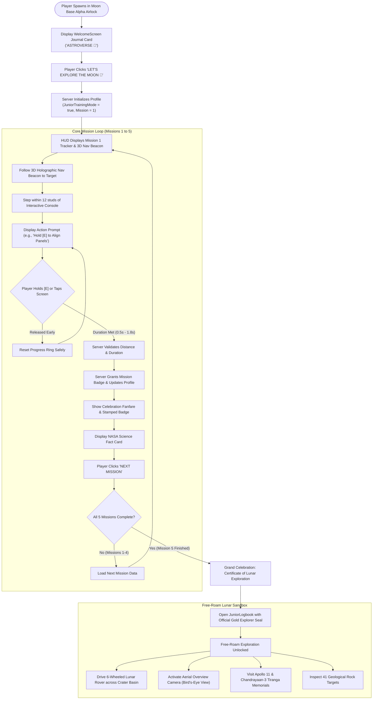

# ASTROVERSE Player Gameplay Flowchart

This diagram visualizes the end-to-end player gameplay loop, from avatar spawn and sketchbook journal introduction, through the five training missions, to rover driving, aerial observation, and graduation.

---

[Back to Gameplay Flow Documentation](../GAMEPLAY_FLOW.md)
