# ASTROVERSE Five-Mission Progression Diagram

This diagram details the educational progression, interactive targets, hold durations, and badge rewards across the five junior astronaut training missions.

```mermaid
stateDiagram-v2
    [*] --> WelcomeScreen: Player Joins Game
    
    WelcomeScreen --> Mission1: Click 'LET'S EXPLORE THE MOON'
    
    state "Mission 1: POWER THE MOON BASE" as Mission1 {
        Target_M1: Target - Solar Power Switch (24.6, 9.3, 223.2)
        Action_M1: Hold [E] for 1.5 seconds
        STEM_M1: Photovoltaic power on airless celestial bodies
        Badge_M1: Earn Badge 'Power Pioneer' ☀️
        
        Target_M1 --> Action_M1
        Action_M1 --> STEM_M1
        STEM_M1 --> Badge_M1
    }
    
    Mission1 --> Mission2: Advance to Life Support
    
    state "Mission 2: KEEP THE ASTRONAUT SAFE" as Mission2 {
        Target_M2: Target - Life Support Oxygen Tank (-13.0, 11.3, 274.5)
        Action_M2: Press [E] for 0.5 seconds
        STEM_M2: NASA ECLSS closed-loop oxygen & moisture recycling
        Badge_M2: Earn Badge 'Life Support Hero' 💨
        
        Target_M2 --> Action_M2
        Action_M2 --> STEM_M2
        STEM_M2 --> Badge_M2
    }
    
    Mission2 --> Mission3: Advance to Radiation Shielding
    
    state "Mission 3: SHIELD OUR BASE" as Mission3 {
        Target_M3: Target - Regolith Shield Console (0.0, 14.0, 245.0)
        Action_M3: Hold [E] for 1.8 seconds
        STEM_M3: Cosmic rays & in-situ regolith mass shielding
        Badge_M3: Earn Badge 'Radiation Defender' 🛡️
        
        Target_M3 --> Action_M3
        Action_M3 --> STEM_M3
        STEM_M3 --> Badge_M3
    }
    
    Mission3 --> Mission4: Advance to Space Botany
    
    state "Mission 4: GROW FOOD ON THE MOON" as Mission4 {
        Target_M4: Target - Greenhouse Hydroponic Bay (-36.5, 10.0, 250.0)
        Action_M4: Press [E] for 0.5 seconds
        STEM_M4: NASA Veggie & Advanced Plant Habitat (APH)
        Badge_M4: Earn Badge 'Space Botanist' 🌱
        
        Target_M4 --> Action_M4
        Action_M4 --> STEM_M4
        STEM_M4 --> Badge_M4
    }
    
    Mission4 --> Mission5: Advance to Space Weather Watch
    
    state "Mission 5: SOLAR WEATHER WATCH" as Mission5 {
        Target_M5: Target - Central Mission Control Desk (4.5, 11.0, 255.2)
        Action_M5: Hold [E] for 1.5 seconds
        STEM_M5: NASA CCMC DONKI solar flare monitoring & storm drill
        Badge_M5: Earn Badge 'Master Junior Astronaut' ⚡
        
        Target_M5 --> Action_M5
        Action_M5 --> STEM_M5
        STEM_M5 --> Badge_M5
    }
    
    Mission5 --> Graduation: Complete All 5 Missions
    
    state Graduation {
        Cert: Official Certificate of Lunar Exploration
        Seal: Embossed Gold Explorer Seal
        Journal: Complete 5/5 Stamped Badge Grid
    }
    
    Graduation --> [*]: Free-Roam Exploration & Rover Driving
```

---

[Back to Mission Design Documentation](../MISSION_DESIGN.md)
