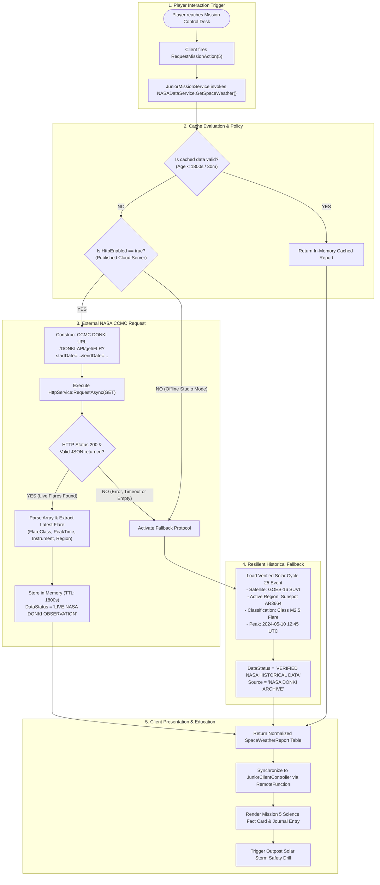

# ASTROVERSE NASA Data Pipeline Diagram

This diagram maps the complete data lifecycle of the NASA CCMC DONKI integration within ASTROVERSE, illustrating request routing, in-memory caching, offline Studio failover, and client presentation.

---

[Back to NASA Data Integration Documentation](../NASA_DATA_INTEGRATION.md)
