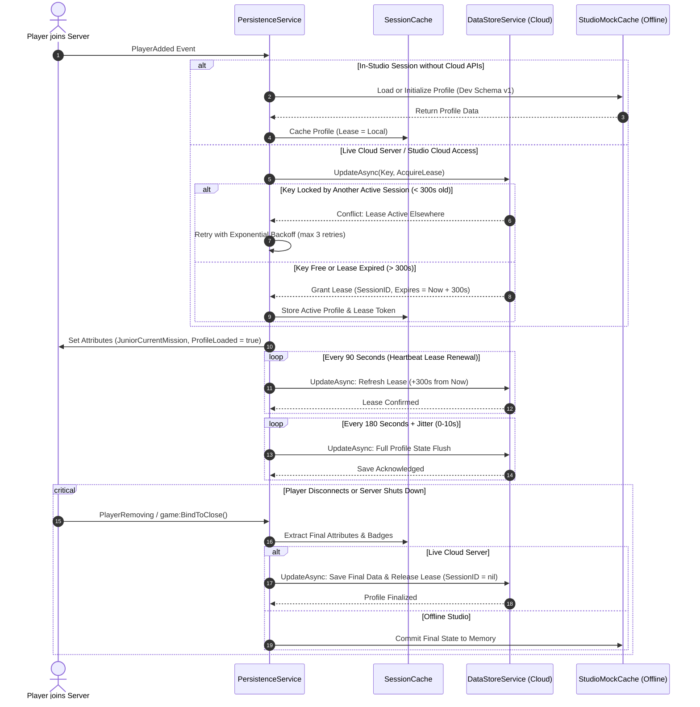

# ASTROVERSE Data Persistence & Session Locking Flowchart

This diagram illustrates the session-hardened player persistence lifecycle implemented in `ServerScriptService.PersistenceService`, showing session lease acquisition, heartbeat renewal, periodic autosaving, and shutdown flushing.

---

[Back to System Architecture Documentation](../SYSTEM_ARCHITECTURE.md)
