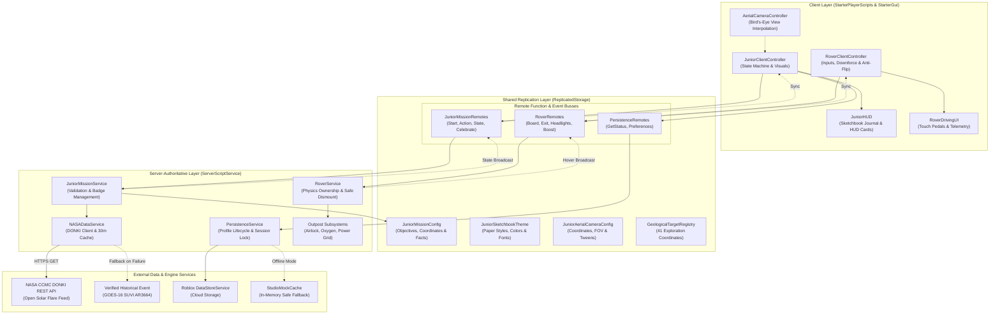

# ASTROVERSE Architecture Diagram

This document contains the complete system architecture diagram for ASTROVERSE, illustrating the communication flow between the Roblox client, shared replication modules, server-authoritative services, and external open science APIs.

---

[Back to System Architecture Documentation](../SYSTEM_ARCHITECTURE.md)
